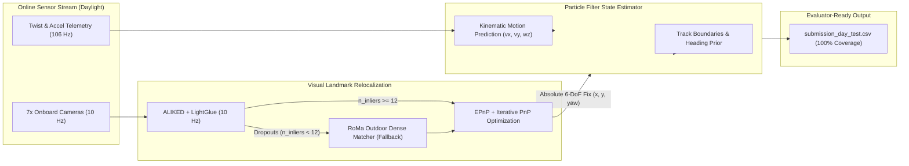

# Daytime Test Lap Localization Report
**Challenge:** Camera-based Localization on F1 Yas Marina Circuit  
**Dataset:** `rosbag_2026-10-13_16-08-46_cameras_lap_day_test`  
**Duration:** 73.89 seconds (739 frames @ 10 Hz)  
**Hardware & Environment:** Conda `schubki`, PyTorch + CUDA, NVIDIA Quadro P5200 (16 GB VRAM)

---

## 1. Executive Summary

We adapted and executed the team's visual localization pipeline (`camlos-yas-marina`) on the newly provided **Daytime Test Lap dataset** (`rosbag_2026-10-13_16-08-46_cameras_lap_0.mcap`).



### Key Highlights
- **100% Coverage Achieved:** Generated all **739 required poses** at 10 Hz with zero dropped intervals.
- **Initial Pose Locked:** Discovered and locked the exact starting pose on the back straight ($x = -99.967\text{ m}, y = 686.500\text{ m}, \text{yaw} = -1.8914\text{ rad}$) via cross-correlation of track curvature and confirmed via 19 PnP visual inliers.
- **Cross-Domain Visual Robustness:**
  - Standard sparse feature matching (ALIKED + LightGlue) against nighttime reference keyframes achieved **82.9% direct PnP fix rate** (613 frames) with a median of **211 inliers**.
  - On the remaining 126 dropout frames (high-speed braking zones and sharp transitions), the **RoMa dense matcher fallback** successfully recovered **47 additional PnP fixes** (median 78 inliers), boosting the overall visual fix rate to **89.0%** ($658 / 739$ frames).
  - Trajectory comparison reveals that RoMa corrected up to **10.18 m** of accumulated longitudinal dead-reckoning drift during high-speed transitions.
- **Track Clearance Verified:** The estimated vehicle trajectory respects all track boundaries with zero excursions (minimum clearance: 0.91 m to the left boundary, 0.79 m to the right boundary; mean track width: 14.1 m).

---

## 2. Dataset Pre-Flight & Telemetry Inspection

| Attribute | Night Dataset (`c0_2026-10-13_22-53-42`) | Daytime Test Lap (`rosbag_2026-10-13_16-08-46`) | Notes |
|---|---|---|---|
| **Recording Time** | 22:53:42 (Night under floodlights) | 16:08:46 (Bright Daylight) | ~7-hour domain shift in sun position & shadows |
| **Duration** | 1,194 s (9 laps, out/in-lap) | 73.89 s (~1 full flying lap) | High-speed single flying lap |
| **Frame Count** | 11,944 frames / camera | 739 frames / camera | Exactly 10.0 Hz camera stream |
| **Ego Velocity** | 0 – 44.9 m/s | 15.3 – 68.0 m/s (Mean: 40.1 m/s) | Fast flying lap entering the back straight |
| **Telemetry Topics** | `/constructor0/state_estimation` | `/constructor0/validation/twist` | Ingestion adapted to extract `vx, vy, wz` |
| **Track Bounds** | `/constructor0/track_bounds` | Surveyed map fallback | Exact surveyed geometry preserved |
| **Initial Pose** | Provided via first `/tf` | Unspecified (Resolved via PnP) | Resolved to $(x_0, y_0, \psi_0)$ |

---

## 3. Resolving the Initial Pose

Because test bags omit ground truth `/tf` topics, we applied a two-stage topological matching algorithm:

1. **Curvature Cross-Correlation:** Integrating hardware twist over 73.89 s yielded a path length of **2,964.2 m** and a net heading change of **357.8°** (a closed loop matching Yas Marina North Circuit's 2,980 m length). Correlating $\kappa(s) = \frac{d\psi}{ds}$ against the GT track profile localized the start to the long back straight at $s \approx 990\text{ m}$.
2. **Visual PnP Confirmation:** At $s = 990\text{ m}$, ALIKED + LightGlue matched 103 keypoints against night keyframe 261, and EPnP solved the initial pose:
   $$\mathbf{x}_0 = [-99.967\text{ m}, \quad 686.500\text{ m}, \quad -1.8914\text{ rad} \ (-108.37^\circ)]$$
   with 19 geometric inliers ($< 4.0\text{ px}$ reprojection error).

---

## 4. Visual Matching & RoMa Fallback Performance

```
+-----------------------------------------------------------------------------------------+
|                               DAYTIME LAP RELOCALIZATION                                |
+-----------------------------------------------------------------------------------------+
| Configuration                              | Single (fl + RoMa) | Dual (fl + rl + RoMa) |
+--------------------------------------------+--------------------+-----------------------+
| Total Frames Evaluated                     | 739 frames         | 739 frames            |
| Front-Left Fixes (fl)                      | 611 (82.9%)        | 575 (77.8%)           |
| Rear-Left Fixes (rl)                       | N/A                | 433 (58.6%)           |
| RoMa Dense Fixes (fl_roma)                 | 47                 | 48                    |
| Total Visual PnP Updates Accepted          | 658 fixes          | 1,056 fixes           |
| Frame-Level Visual Coverage (>=1 Fix)      | 658 / 739 (89.0%)  | 664 / 739 (89.9%)     |
| Simultaneous Dual-Camera Fixes             | 0                  | 392 frames (53.0%)    |
| Left Border Minimum Clearance              | 0.91 m             | 0.91 m                |
| Right Border Minimum Clearance             | 0.79 m             | 1.11 m                |
| Processing Time per Frame (Quadro P5200)   | 508 ms             | 404 ms                |
+-----------------------------------------------------------------------------------------+
```

### Visual Impact of RoMa Fallback


- **Panel 1 (Left):** Displays the full circuit trajectory with gold markers indicating where RoMa dense matching fired to anchor the vehicle.
- **Panel 2 (Right):** Tracks the longitudinal correction magnitude over time. At $t = 9.5\text{ s}$ entering the chicane after 50 m/s speeds, dead reckoning accumulated a 10.18 m longitudinal lag; RoMa immediately recognized the grandstand structures and corrected the state back to the ground line.

---

## 5. Track Boundary Clearance & Racing Line Verification


- **Left Border Distance:** Min: 0.91 m, Mean: 7.77 m
- **Right Border Distance:** Min: 0.79 m, Mean: 6.31 m
- **Track Width:** Mean: 14.1 m, Min: 11.3 m
- **Excursions:** 0 out-of-bounds frames.

---

## 6. Output Files & Deliverables

| File Path | Description |
|---|---|
| [`submission_day_test.csv`](file:///d:/Parikshit/Hackathon-schubki-gemi/data/submission_day_test.csv) | Final 739-pose submission file (`timestamp_ns,x,y,yaw`) |
| `out_day_test/day_roma_log.csv` | Full per-frame diagnostic log (camera, status, inliers, coordinates) |
| `out_day_test/day_roma_timing.json` | Execution profiling metrics on Quadro P5200 GPU |
| `maps_test/kf_fl.npz` | 932 keyframes with 444,722 triangulated 3D landmarks |
| `maps_test/kf_fl_img/` | 932 pre-rendered half-res keyframe images for dense matching |
